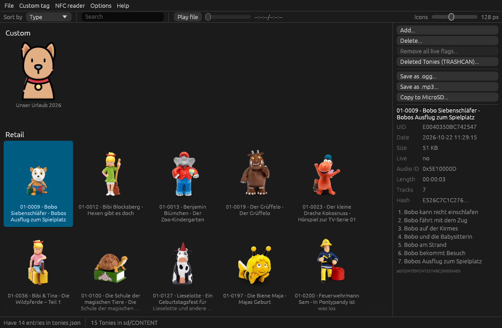

# Teddy / TeddyBench




Tools for working with the audio files of the Toniebox: dump existing Tonie files, decode them to Ogg/MP3,
or create your own custom content. For Windows, Linux and macOS.

| Tool | Description |
|---|---|
| **TeddyBench** | GUI. Browse the `CONTENT` folder of a Toniebox SD card, play, export, encode and manage Tonie files, and work with NFC tags. |
| **teddy** | Command-line tool for decoding, encoding, inspecting and renaming Tonie files. |

This repository is a fork of [toniebox-reverse-engineering/teddy](https://github.com/toniebox-reverse-engineering/teddy),
rewritten in Rust. The original C# implementation for Windows (`TeddyBench.exe`, `Teddy.exe`) was removed;
its last releases (`v1.x`) stay on the releases page, and its code is in the git history up to the 0.1.4
release. The settings, custom names and Tonie files are compatible, so you can switch at any time.
[TODO.md](TODO.md) lists what is still missing or untested.

## Download

Download the [latest release](https://github.com/StefanRiese/teddy/releases/latest) (tagged `rust-v*`);
[CHANGELOG.md](CHANGELOG.md) lists what changed in each version:

| File | Platform |
|---|---|
| `teddy-rust-windows-x64.zip` | Windows (64 bit) |
| `teddy-rust-macos-universal.dmg` | macOS 11 or later, Apple Silicon and Intel |
| `teddy-rust-linux-x64.tar.gz` | Linux (x86-64, needs ALSA for playback) |

Each download contains TeddyBench and `teddy`.

- **macOS:** drag TeddyBench.app into Applications. The app is not signed with an Apple Developer ID: the
  first time, right-click it → Open, or run `xattr -dr com.apple.quarantine /Applications/TeddyBench.app`.
- **Linux:** `./install-desktop-entry.sh` in the unpacked archive adds TeddyBench with its icon to the
  application menu of the current user (`--uninstall` removes it again).

## TeddyBench

`teddybench [directory]` opens the given `CONTENT` directory, a `Content` folder next to the program (handy
for a local working copy), or the first SD card with a `CONTENT` folder that shows up.

### Features

- Cover grid with names and covers from `toniesV2.json` of the
  [tonies-json](https://github.com/toniebox-reverse-engineering/tonies-json) repository (`tonies.json` from
  [api.revvox.de](https://api.revvox.de/tonies.json) if GitHub fails)
  and your own names from `customTonies.json`; icon size slider, sorting by UID, product number, date or type.
- **Search** by name, UID, folder or audio ID: start typing anywhere, Esc clears the search. Only the
  Tonies found stay selected, so actions never affect hidden ones.
- Keyboard: arrow keys, Home and End select the next, first or last Tonie, Space plays or stops it;
  F1 (*Help → Keyboard shortcuts*) lists all shortcuts.
- Details of the selected Tonie (UID, date, size, audio ID, length) with its track list, playback with
  seeking. *File → Refresh* (F5) reads the card again.
- Create Tonie files from audio files (MP3, Ogg Opus, Ogg Vorbis, FLAC, WAV, M4A; also by drag and drop
  onto the window) or add an existing Tonie file. The tracks are ordered by folder (e.g. the discs of an
  album) and ID3 track number; drag them or use Up/Down to change the order, add and remove files. The new Tonie is named after the tags
  of the files (album artist and album) or their folder. Each new Tonie gets its own audio ID, also when
  several are made within a second. Ogg Opus files that fit a Tonie (stereo, 20 ms packets), e.g. tracks
  exported with *Save as .ogg*, are copied **without re-encoding**, so they keep their quality.
- Rename, delete, toggle the live flag, assign a new or a **random UID**, show in the file manager.
  **Change audio ID** gives a Tonie a new or a chosen audio ID without re-encoding it.
- **Edit tracks** of an existing Tonie: add audio files, remove or reorder tracks. The tracks it keeps are
  copied without re-encoding, so they keep their quality; only added files are encoded.
  **Remove all live flags** (Ctrl+L, on macOS Cmd+L) clears the flag of every Tonie on the card at once.
- **Deleted Tonies (TRASHCAN):** a Toniebox connected to the cloud moves deleted Tonies into the `TRASHCAN`
  folder next to `CONTENT` instead of deleting them. TeddyBench lists them with name, audio ID, length and
  deletion date, and restores them for a tag UID (entered, or read with the NFC reader) byte for byte or as
  a new Tonie with a new audio ID (without re-encoding), or deletes them permanently. A Tonie already on
  the card for that UID can be replaced; it goes into the TRASHCAN instead.
- Export the selected Tonies (see [Exporting audio](#exporting-audio)) or their Tonie files, or use
  **Copy to MicroSD** to copy the selected Tonie folders to another SD card.
- **Custom tag covers:** printable A4 PDFs with round cover images for the selected Tonies
  (*Custom tag → Create tag cover*, full resolution covers where available), and a matching backside with
  series name and model number (*Custom tag → Create tag backside*). *Custom tag → Print layout* sets
  sizes, gaps and where to start on a partly used sheet.
- NFC readers, see [NFC readers](#nfc-readers).
- *Options*: download `tonies.json` on startup or now, show the debug window with the background messages.
  *Help → Releases page* links to the releases.

The live flag is the FAT hidden attribute of the Tonie file. On Linux it can only be changed on the SD card
itself (vfat), not on a copy on another file system.

### Putting your own audio on a figure

The Toniebox plays the Tonie file that belongs to the UID of the figure's tag: a file in `CONTENT` on its SD card,
in a folder named after the UID in reverse byte order (UID `E0040350010C0B0A` → `CONTENT/0A0B0C01/500304E0`).
To give a figure your own audio, replace that file:

1. Put the figure on the Toniebox once while the box is online, so it downloads the figure's Tonie onto the SD
   card. Then switch the box off, take out the SD card and put it into your computer. TeddyBench opens it by
   itself.
2. Find the figure's Tonie in TeddyBench: by its name and cover, with the search, or by putting the figure on
   an [NFC reader](#nfc-readers), which selects it. The details show its UID.
3. To keep the original audio, export it first: *Save as .ogg* (it can be put back later without loss) or
   *Export Tonie file*.
4. Then either use **Edit tracks** (context menu) to replace, add or reorder tracks, or **Add...** your audio
   files and enter the figure's UID (with an NFC reader it is filled in): the new Tonie replaces the old one.
5. Put the SD card back into the box and put the figure on it.

A Toniebox that is connected to the cloud may replace changed content with the original again, or move it into
the TRASHCAN (see *Deleted Tonies*); keep that in mind when the box is online.

### Exporting audio

Select one or more Tonies and export them:

- **.ogg:** dumps the tracks as `Track_01.ogg`, `Track_02.ogg`, …
- **.mp3:** converts the tracks to MP3 in parallel, with ID3v2.3 tags: artist (series), album (episode),
  track title from `tonies.json`, track number (`3/12`) and the cover as embedded album art. A track's
  `.ogg` is only deleted after its MP3 was written successfully.
- **Update covers:** downloads the cover image again into folders that were already exported, without
  touching the audio.

Exports run in the background with a progress dialog and can be cancelled. You can choose whether each
Tonie gets its own subfolder; each folder also gets a `cover.jpg`/`cover.png`. Tonies whose folder already
contains MP3 files and no unconverted `.ogg` files are skipped, so an interrupted or partly failed batch can
be restarted. Exports go to an `Export` folder next to the program on Windows and Linux
(`~/Music/TeddyBench Export` on macOS, or if the program directory is read-only); the folder chosen last is
remembered.

### NFC readers

Enable the reader and choose its type in the *NFC reader* menu. It is searched on the USB serial ports; the
UID of a tag put on it selects its Tonie (also when the card is opened later) and is filled in when assigning
a UID or creating a Tonie. UID fields start with `E0040350`, so only the last 8 digits printed on the tag
need to be entered.
`TEDDYBENCH_NFC_PORT=<port>` uses that port instead of searching. On Linux the user needs to be in the
`dialout` group.

- **Proxmark3:** unlocking tags in privacy mode needs the firmware with the
  [SLIX-L features](https://github.com/g3gg0/proxmark3/tree/iso15693_slix_l_features), as do reading and
  emulating tags and the console mode (*NFC reader → Advanced actions*). The antenna measurement works with
  any firmware. Flash the firmware with the Proxmark3 tools.
- **ESP with PN5180:** an ESP microcontroller with a PN5180 NFC module, connected via USB serial at
  115200 baud. TeddyBench detects it by sending `v` and expecting a response containing `Pn5180Esp`; `i`
  returns the 16-character tag UID and `u` unlocks a tag in privacy mode (reply `ok`).

### Data files and settings

`teddyBench.cfg`, `toniesV2.json` / `tonies.json`, `customTonies.json` and the image cache (`cache/`) are kept next to the
program; in the macOS app inside `TeddyBench.app/Contents/Data`. If that location is read-only (e.g.
`Program Files`, or macOS running a downloaded app before it was moved to Applications), the user's data
directory is used instead: `%APPDATA%\TeddyBench\data` on Windows, `~/Library/Application Support/TeddyBench`
on macOS, `~/.local/share/teddybench` on Linux. *Options* shows the directory in use.

On macOS, replacing TeddyBench.app with a new version also replaces `Contents/Data`. Copy
`customTonies.json` and `teddyBench.cfg` over to keep custom names and settings.

The settings are JSON; most of them can be changed in the menus. Edit the file while TeddyBench is closed.

| Setting | Default | Description |
|---|---|---|
| `NfcEnabled` | `false` | Enable the NFC reader. |
| `NfcType` | `"Proxmark3"` | NFC reader type: `"Proxmark3"` or `"Pn5180Esp"`. |
| `DebugWindow` | `false` | Show the debug window. |
| `DownloadJson` | `true` | Download `toniesV2.json` on startup. Set to `false` to keep a locally modified file: of `toniesV2.json` and `tonies.json` (old format), the one changed last is used. If neither exists, it is still downloaded. |
| `CacheImageSize` | `256` | Resolution of cached cover images in pixels. |
| `IconSize` | `128` | Size of the covers in the grid, in pixels. |
| `SortBy` | `"Date"` | Sort order: `"UID"`, `"Product"`, `"Date"` or `"Type"`. |
| `CustomTagNonPrintableMargin` | `15` | Page margin the printer cannot print on, in mm. |
| `CustomTagGapX` / `CustomTagGapY` | `5` | Horizontal / vertical gap between two covers, in mm. |
| `CustomTagInitialColumn` / `CustomTagInitialRow` | `0` | Position of the first cover on the first page, so you can reuse a partially printed sheet. |
| `CustomTagSize` | `40` | Diameter of a cover, in mm. |
| `CustomTagOutlineWidth` | `0.5` | Width of the cutting outline around each cover; `0` disables it. |
| `CustomTagCoverFilename` | `"CustomTagCover.pdf"` | File name of the generated cover PDF. |
| `CustomTagBacksideFilename` | `"CustomTagBackside.pdf"` | File name of the generated backside PDF. |

## teddy (command line)

```
teddy -m info <toniefile|directory>
teddy -m decode [-s] [-o <dir>] <toniefile|directory>
teddy -m encode [-o <file|dir>] [-i <audio id>] [-b <kbps>] [--vbr] [--reencode] [-p <prefix dir>] <folder | files...>
teddy -m rename [-y] [-d] <source dir> <dest dir>
```

| Option | Description |
|---|---|
| `-m`, `--mode` | Operating mode: `info`, `decode`, `encode`, `rename` |
| `-o`, `--output` | Where to write the file(s) to |
| `-p`, `--prefix` | encode: location of prefix files |
| `-i`, `--id` | encode: AudioID to use (default: current time) |
| `-b`, `--bitrate` | encode: Opus bit rate in kbps |
| `--vbr` | encode: use VBR encoding |
| `--reencode` | encode: encode Ogg Opus files again instead of copying them unchanged |
| `-s` | decode: export as a single `.ogg` file |
| `-y` | rename: actually rename files (otherwise dry run) |
| `-d` | rename: delete duplicates |
| `-w`, `--write` | info: write updated JSON to a local file |
| `-j`, `--json` | `tonies.json` or `toniesV2.json` file/URL with details about Tonies (default: `toniesV2.json` from GitHub, `tonies.json` from api.revvox.de if that fails) |
| `-f`, `--format` | Output details as `csv`, `json` or `text` |
| `-v` | Increase debug verbosity |
| `-h`, `--help` | Show help |
| `-V`, `--version` | Show the version |
| `--license` | Show licenses and disclaimer |

Examples:

```
teddy -m info 500304E0                              Show header details
teddy -m decode -o out/ 500304E0                    Dump the audio as .ogg files
teddy -m encode -o 500304E0 track1.mp3 track2.mp3   Create a Tonie file from audio files
teddy -m encode -o out/ my-album/                   Create a Tonie file from all audio files in a folder
teddy -m rename <source dir> <destination dir>      Move Tonie files to readable names (dry run without -y)
```

`encode` reads MP3, Ogg Opus, Ogg Vorbis, FLAC, WAV and M4A (AAC, ALAC) files; the files of a folder are ordered by their ID3 track
number. Ogg Opus files that fit a Tonie (stereo, 20 ms packets) are copied without re-encoding, unless
`--reencode` or prefix files are given; the bit rate does not apply to them. The bit rate must be a multiple
of 24 kbps, otherwise the output file is incompatible. Prefix files
(`0001.mp3`, `0002.mp3`, …) in the `--prefix` location are prepended to the matching track, e.g. to announce
the track number.

## Building

```
cargo build --release
```

| Crate | Description |
|---|---|
| `tonie-core` | Reading and writing Tonie files: header, Ogg page layout, decode, encode, `info` reports, `tonies.json` |
| `teddy` | Command-line tool |
| `teddybench` | GUI (egui) |

libopus and LAME are compiled from source, which needs CMake and a C compiler. On Linux, audio playback also
needs the ALSA headers (`libasound2-dev` on Debian/Ubuntu). On macOS, `packaging/macos/bundle.sh <file.dmg>`
builds TeddyBench.app and `teddy` as universal binaries (Apple Silicon and Intel) and packs them into a disk
image.

The workflow `.github/workflows/rust.yml` checks formatting, runs clippy and the tests on Windows, Linux and
macOS and builds the downloads on every push. Pushing a `rust-v*` tag publishes them as a release.

## Tests

`cargo test` compares the output with the original C# `Teddy.exe`, stored in `tests/fixtures/reference`.
Those files were generated from the synthetic inputs in `tests/fixtures/inputs` (`make_inputs.sh`) with
`generate_reference.ps1` and `Teddy.exe`, which is in the git history up to the 0.1.4 release.

- `info` (text, CSV, JSON) and `decode` output match byte for byte.
- The Ogg page layout matches byte for byte: the reference's Opus packets are replayed through the page
  writer. The Opus packets themselves differ, because libopus is used instead of Concentus.
- Encoded files are compared structurally: header, chapters, segments per page, duration.

## Differences from the C# version

Intentional fixes:

- **Track order:** folders are sorted by the ID3 track number. Teddy.exe could not read track numbers with a
  NUL terminator (as written by ffmpeg and many taggers) and silently fell back to file name order.
- **Ogg input:** `.ogg` files are always decoded at 48 kHz. Teddy.exe used the bit rate as decoder sample
  rate, so encoding Ogg files only worked with `-b 48`.
- **End of each file:** Teddy.exe encoded up to 60 ms of stale audio after every source file (and prefix
  file). Files encoded now are that much shorter.
- **`info -f json`** writes valid JSON (no separator before the first entry).
- **Exit code** is non-zero when something failed; a failed encode leaves no partial file behind.
- More input formats: MP3, Ogg Opus, Ogg Vorbis, FLAC, WAV and M4A (Teddy.exe: MP3 and Ogg).
- The tag backside PDF is saved as `CustomTagBacksideFilename`; the C# version overwrote the cover PDF.
- Removing a tag from an ESP with PN5180 deselects its Tonie again, like with a Proxmark3.
- Track names from `tonies.json` are only used when their number matches the tracks of the file; Teddy.exe
  assigned them by position, so the tracks of a re-release with other tracks got wrong names.

Other differences:

- Resampling (rubato) and MP3 decoding (symphonia) differ from Windows Media Foundation/ACM, so the encoded
  audio is not bit-identical.
- The progress dots of `encode` depend on the decoder and differ slightly.
- `--license` lists the Rust dependencies instead of the .NET ones.
- Not available: flashing the Proxmark3 firmware and the ffmpeg-based MP3 modes (the MP3 export works like
  the former "native" mode). Dropped on purpose: the automatic update download and the diagnostics reports,
  which were sent to a server of the original project.

## Credits

Based on the work of the [toniebox-reverse-engineering](https://github.com/toniebox-reverse-engineering)
community and [Hasenpups/teddy](https://github.com/Hasenpups/teddy).
